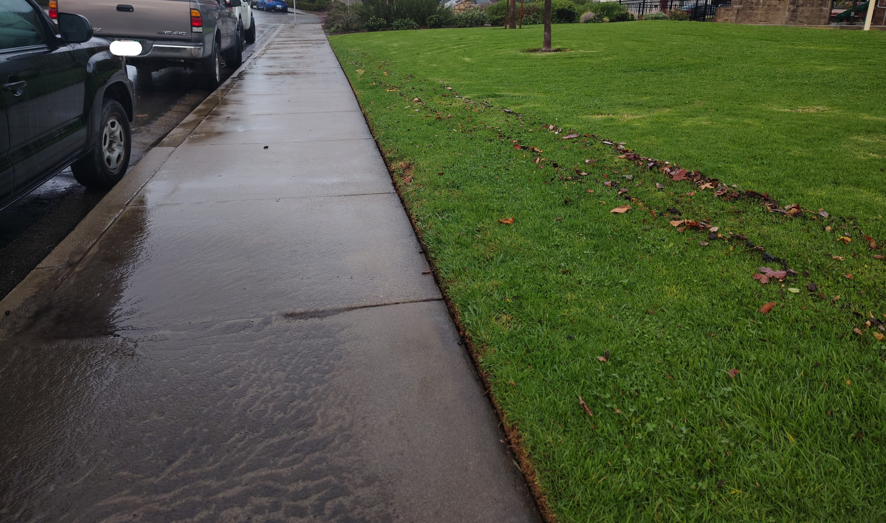

---
date:
  created: 2026-11-22
authors:
  - RY4GIT
slug: slo-streamflow-forecast-retrospective
---

# San Luis Obispo streamflow forecast: a retrospective
Around midnight on Nov 18, City of San Luis Obispo (SLO) was hit by its first major atmospheric river storm of the season. Houses and streets flooded, and a sinkhole appeared. According to [CalCoastNews](https://calcoastnews.com/2026/11/see-how-much-rainfall-fell-from-storm-that-soaked-san-luis-obispo-county/), 3-day rain totals reached 3.33 in at San Luis Obispo and 5.71 in at Rocky Butte near San Simeon. This came on top of the 200-400% above-average precipitation in the preceding 90-days before Nov 14 ([NOAA Climate Prediction Center update on Nov 16, 2026](https://www.cpc.ncep.noaa.gov/products/analysis_monitoring/lanina/enso_evolution-status-fcsts-web.pdf)). 

  

In this post, I retrospectively, and anecdotally, look back at the flood as a SLO resident and a hydrologist. With a retrospective analysis of the National Water Model (NWM) forecasts, I'll share what I learned about flood preparedness.

## 1. Timeline (as a resident)
I was relaxing on the couch when the flood warning reached my phone at 10:43 PM. I looked outside, and the street was **already flooded**, with water about 6–10 inches deep. I rushed through the floodwater to my car. Luckily, the car started, and I moved it to higher ground.

*Once I was back home, I asked myself: is the water still rising?*

At that time, the closest official NOAA forecast was for Paso Robles, 30 miles away, issued by the NOAA Los Angeles/Oxnard office. However, when I looked at the forecast, this is what it showed:

  

The observed flow was rising much faster than forecast! The peak was off by about 3-4 hours, and the forecast looks either very outdated (issued 7–10 hours earlier) or not reflecting the natural flow.

The SLO county operates [stream gauges](https://wr.slocountywater.org/), but these rivers do not receive official NOAA forecasts. While I was scrambling to understand the situation (and disinfecting my boots, pants, etc), the flow eventually subsided. Relieved, but I couldn't help asking myself:

**How did I not notice the flood coming? And why was the street already flooded when the flood warning came through?**

Then I remembered that the NOAA Office of Water Prediction's National Water Model (NWM) provides streamflow forecasts for almost every river reach across the US. 

It was buried deep, and I couldn't find it quickly on my phone during the flood. But if you go to https://water.noaa.gov/map, open the **"National Water Model"** tab, and activate the **"Stream reach"** layer, you can find forecasts made for 2.7 million reaches across the US, including SLO creeks. It shows a scary disclaimer: "*The NWM output provides supplemental guidance to NWS forecasters and should not be considered an official NWS river forecast.*" But this is (probably the only way) how you can tell whether the stream in your backyard is going to flood!! And looking back, it caught the timing of the flood peak really well. With the NOAA NWM, you don't have to wait for an official forecast but check this open-access flood forecasts anytime right at your fingertips.

## 2. Looking back at the NWM forecasts (as a hydrologist)
In addition to real-time forecasts, NOAA keeps what's called a **hindcast**: an archived record of what flow was predicted at the time each forecast was made. This lets you look back and evaluate how well the NWM forecasted an event. The NWM output is stored in the NOAA Open Data AWS bucket, which you can access through the CIROH Data Access Hub: https://hub.ciroh.org/docs/products/data-management/dataaccess/. Our editorial board member Tadd Bindas has previously written [an article on how to access these datasets](https://deepgroundwater.com/blog/coding-blog-how-to-access-nwm-forcings-using-virtualizarr/).

I pulled short-range (18-hour) forecasts for a several river reaches near SLO and one at Paso Robles, from four initialization times on Nov 18 ([scripts](https://github.com/DeepGroundwater/slo2026)):
- **6 AM PST**: the morning of the flood
- **12 PM and 6 PM PST**: several hours before the flood
- **10 PM PST**: right around the start of the flood

So let's look at what happened. Note that for the SLO reaches, the observed peak flow magnitude is unknown, because the gauges only measure stage. So the analysis here focuses on the timing of the peak.

  

### SLO Creek vs. Marsh St and Elks Ln stage

  

- The forecast made at 6 AM did not predict a large peak.
- The forecasts made at 12 PM and 6 PM (5–10 hours prior to the flood) showed a sharp peak of about 800 cfs at 10–11 PM. The observed stage peaked around 11PM–12AM. I'd call this a successful prediction, because predicting the peak early is on the safer side
- The flood watch came in good time, whereas the flash flood warning arrived only 0.5–1 hour before the peak, leaving us very little time to respond.

### Stenner Creek vs. Nipomo St stage

  

- Similar pattern is found. The forecast peak was at 10–11 PM, and the observed peak was at 11PM–12AM. The runs initialized at 12 PM and 6 PM (5–10 hours prior) predicted an unusually high flow. 

### Old Garden Creek (no gauge)

  

- This area flooded as well. Successful example of NWM prediction for a small, ungauged creek! 
- You can also see that the timing of the forecasted precipitation matched the retrospective analysis, although most runs across SLO watersheds **under-predicted the peak-hour rainfall**: 10–20 mm/h in the forecasts (driven by HRRR/RAP) vs. 25–30 mm/h in the analysis (driven by MRMS gauge-adjusted radar precipitation blended with HRRR/RAP. See [the NWM website](https://water.noaa.gov/about/nwm) for detailed configuration.

### Salinas River at Paso Robles vs. USGS 11147500 (official NOAA forecast point)

  

- The forecasts initially predicted large flow peaks, but as observed flow data came in and get assimilated, the later runs (6 PM and 10 PM) drifted to match the observations.
- This streamflow pattern (lagged flow and the reduced peak) is something you'd see in controlled releases. In the upstream of this gauge, there is Salinas Dam at Santa Margarita Lake. So there is a possibility that observed/forecasted flow at this location reflects planned discharge rather than (natural) flow conditions that you'd expect in other neighboring reaches. However, I haven't been able to confirm this, so please take this idea as a gran of salt. 

### Flood inundation extent

Also, I briefly compared the flooded areas reported in the [Tribune article](https://amp.sanluisobispo.com/latest-news/article318158848.html) with the FEMA National Flood Hazard Layer. 

- Areas inside the FEMA floodplain (both the 100- and 500-year zones) did flood. Flooding also spread **beyond** the FEMA zones, likely due to clogged or overloaded storm drains
- The FEMA layer helped me plan where to go and which streets to avoid. I treated it as the *minimum* area at risk

## 3. What I learned
- Official forecasts exist at only a few points! While the NOAA NWM gives guidance for **every** river reach
- When you receive a flood watch or advisory:
    - In addition to your local NOAA NWS office guidance, check the NWM streamflow forecast at https://water.noaa.gov/map. Turn on the "National Water Model" layer to see how bad the flooding might get. By the time you receive a flood warning, it might be too late! In Nov 18 SLO flooding case, the warning came after the flooding had already started, but the NWM had "seen" it 5–10 hours earlier. 
    - Check [FEMA's flood map](https://msc.fema.gov/portal/search?AddressQuery=San+Luis+Obispo) to plan your evacuation route. If you are close to the boundary of the flood zone, assume it's going to flood
- The Super El Niño is predicted to peak between January and March 2027!! The season has just begun (see [NOAA Climate Prediction Center update on Nov 16, 2026](https://www.cpc.ncep.noaa.gov/products/analysis_monitoring/lanina/enso_evolution-status-fcsts-web.pdf)).

If you have your own flood experience, I'd love to hear your story at DeepGroundwater (or for this season, should we call it DeepFloodwater) ... :)

  

